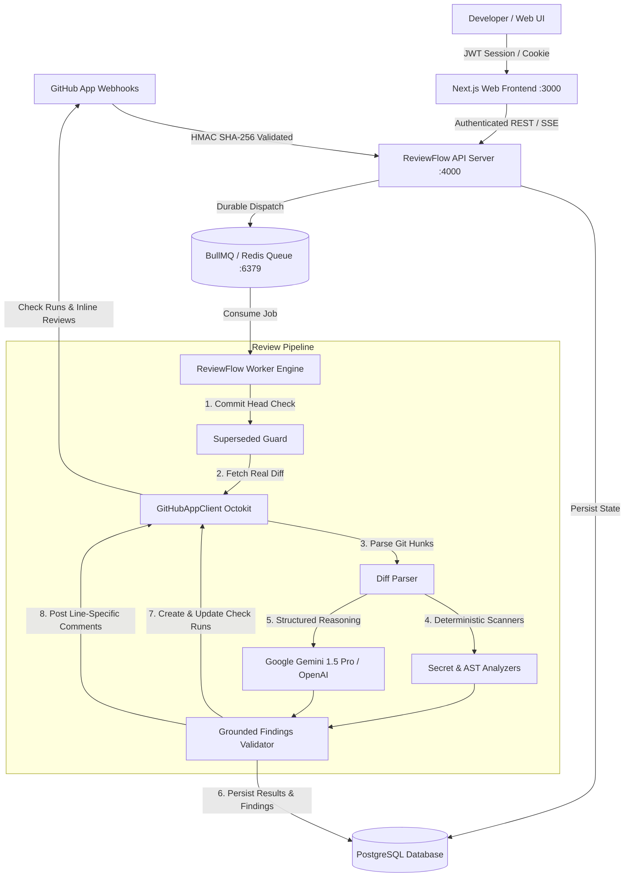

# ReviewFlow AI — Production AI Pull Request Review Platform

> **"Every pull request deserves a senior review."**
> A production-grade SaaS platform that automatically analyzes code changes on pull requests, identifies vulnerabilities and concurrency defects, suggests fixes, validates test coverage, and publishes actionable Check Runs and inline comments directly on GitHub.

---

## 🌟 Real-World Architecture & Capabilities

- **Zero Demo Fallbacks in Real Execution:** No hardcoded users or fake metrics. Live requests validate against real APIs and fail fast with actionable setup blockers when required keys are unconfigured.
- **Server-Enforced Authentication & Sessions:** PBKDF2 with SHA-512 cryptographic password hashing, 30-day database session tracking (`Session` model), JWT token issuance, verification, password reset, and secure logout.
- **Multi-Tenant Isolation:** Guaranteed tenant boundary on every organization, member, repository, pull request, review job, finding, and billing operation. Webhooks lookup tenant organizations strictly via registered `installation.id`—unsafe auto-assignments have been completely eliminated.
- **GitHub App Integration Flow:** Authentic GitHub App RS256 JWT creation, installation token generation, actual git diff retrieval (`Accept: application/vnd.github.v3.diff`), GitHub Check Runs (`checks.create` / `checks.update`), and inline line-level pull request review annotations.
- **Google Gemini & OpenAI Review Engine:** Worker pipeline integrates live Google Gemini 1.5 Pro structured JSON inference with AST-grounded deterministic analyzers. Tokens and latency are persisted to `ReviewJob` and `UsageRecord`. Silent mock substitutions on failed live requests are prohibited.
- **Durable Redis & BullMQ Queues:** Asynchronous review job scheduling with retry backoff, superseded commit detection (cancelling review runs on stale commits), and graceful polling fallback. Production data is never automatically seeded.
- **Stripe Test Mode Billing:** Real Stripe Checkout Session creation (`stripe.checkout.sessions.create`), HMAC signature-verified webhooks (`stripe.webhooks.constructEvent`), and delivery deduplication via `WebhookEvent`.
- **Live SSE Streaming:** Authenticated Server-Sent Events stream real-time database state transitions (`QUEUED` -> `FETCHING_DIFF` -> `ANALYZING` -> `VALIDATING` -> `COMPLETED`) to the dashboard.

---

## 🏗️ System Architecture



---

## 📦 Monorepo Structure

```
ReviewFlow-AI/
├── apps/
│   ├── web/                 # Next.js 14 App Router, Tailwind, Framer Motion, Three.js 3D Hero
│   ├── api/                 # Express REST API, HMAC Webhooks, Rate Limiter, BullMQ Queue
│   └── worker/              # Background review job processor & queue consumer
├── packages/
│   ├── database/            # Prisma ORM schema, PostgreSQL migrations, SQLite dev
│   ├── shared/              # Zod schemas, TypeScript contracts, policy models
│   ├── ai-review/           # Gemini provider, static analyzer, review pipeline
│   └── github-client/       # GitHubAppClient, Octokit, diff parser, webhook verifier
├── tests/
│   ├── unit/                # Diff parser, static analyzer, webhook verifier, github client, auth
│   ├── security/            # Cross-tenant isolation & prompt injection defense tests
│   └── integration/         # Real review flow, schema validation, pipeline tests
├── docs/                    # Architecture, API, Security, Database, Webhooks, Deployment
└── docker-compose.yml       # PostgreSQL 16 & Redis 7 stack
```

---

## 🚀 Quickstart & Startup Commands

### 1. Prerequisites
- **Node.js** 20+ or 24+
- **npm** 10+
- **PostgreSQL** 16 (or local SQLite for lightweight dev)
- **Redis** 7 (for BullMQ queue)

### 2. Environment Configuration
Copy `.env.example` to `.env`:
```bash
cp .env.example .env
```
Fill in your configuration variables:
- `DATABASE_URL`: Your PostgreSQL connection string
- `REDIS_URL`: Redis server URL
- `GITHUB_APP_ID`, `GITHUB_PRIVATE_KEY`, `GITHUB_WEBHOOK_SECRET`: Your GitHub App credentials
- `GEMINI_API_KEY`: Google Gemini API key

### 3. Database Initialization
```bash
# Generate Prisma Client
npm run db:generate

# Push schema to database
npm run db:push

# (Optional for local test fixtures ONLY - prohibited in production)
npm run db:seed
```

### 4. Running the Development Services
Open separate terminal sessions or run simultaneously:

```bash
# 1. API Server (Port 4000)
npm run dev:api

# 2. Background Worker (Queue Consumer)
npm run dev:worker

# 3. Web Dashboard & Marketing (Port 3000)
npm run dev:web
```

---

## 🧪 Automated Testing

Run the test suite across unit, security, and integration layers:

```bash
# Run all automated tests (18 passing tests)
npm test

# Run individual test suites
npm run test:unit
npm run test:security
npm run test:integration
```

---

## 🔒 Security Baseline

1. **Zero Code Execution:** Untrusted diffs are parsed and inspected statically; code is never run in the execution container.
2. **Adversarial Prompt-Injection Defense:** Diff contents and markdown pull request bodies are quarantined as untrusted inputs with boundary markers and adversarial pattern interception.
3. **Tenant Boundary Enforcement:** Every database query filters by `organizationId`. Webhook deliveries resolve tenant organizations strictly via `installationId`.
4. **Timing-Safe HMAC Verification:** Webhook signatures use `crypto.timingSafeEqual` with byte length checks to protect against side-channel attacks.
5. **Session Invalidation:** User logouts and password resets invalidate active database sessions.
