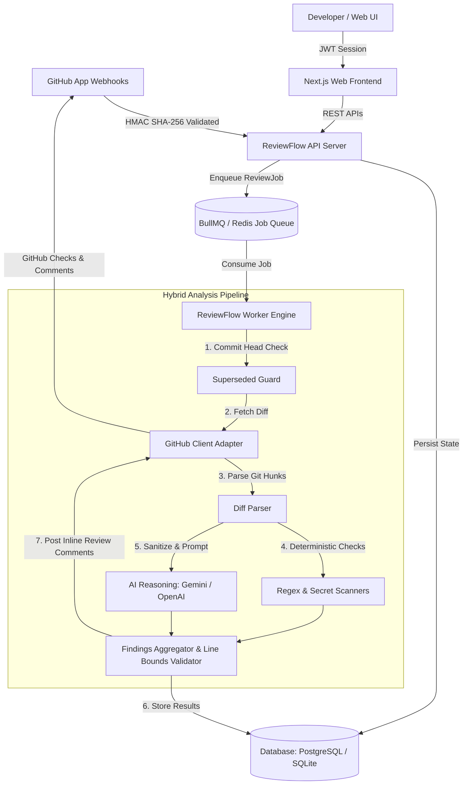

# ReviewFlow AI — Production-Grade AI Pull Request Review Platform

> **"Every pull request deserves a senior review."**
> An enterprise-ready SaaS platform that automatically analyzes code changes, discovers vulnerabilities and logic bugs, suggests patches, evaluates test adequacy, and posts actionable line-level inline comments on GitHub.

---

## 🌟 Key Features

- **Automated Pull-Request Reviews:** Analyzes changes in milliseconds and posts actionable summaries directly to GitHub.
- **Line-Specific GitHub Comments:** Accurately grounds findings to exact git hunk line numbers, preventing API validation errors.
- **Hybrid Review Engine:** Combines instant deterministic static rules (secret leak detection, eval detection, SQL injection guards) with high-context LLM reasoning (Gemini & OpenAI).
- **Prompt-Injection Defense:** Treats code comments and pull request text as untrusted inputs with strict structural isolation and adversarial rule detection.
- **Superseded Commit Safeguard:** Cancels outdated analysis jobs when new commits are pushed to the PR branch, saving token costs and eliminating review noise.
- **Multi-Tenant Organization RBAC:** Complete data isolation across tenants, repositories, review records, and billing settings.
- **Interactive Architecture Explorer:** Live interactive visualization on the marketing website explaining webhook ingestion, queue processing, model inference, and GitHub publication.
- **Full Flagship Dashboard:** Complete Next.js dashboard featuring repository management, pull-request queue, diff viewer with inline findings, severity filtering, dismiss feedback, and Recharts analytics.

---

## 🏗️ System Architecture



---

## 📦 Monorepo Structure

```
ReviewFlow-AI/
├── apps/
│   ├── web/                 # Next.js 14 App Router, Tailwind, Framer Motion, Three.js 3D Hero
│   ├── api/                 # Express & TypeScript REST API, HMAC Webhooks, OpenAPI specs
│   └── worker/              # Background review job processor & queue consumer
├── packages/
│   ├── database/            # Prisma ORM schema, SQLite/PostgreSQL, migrations & seeds
│   ├── shared/              # Zod schemas, TypeScript types, policy definitions
│   ├── ai-review/           # Deterministic scanners, prompt builders, LLM adapters
│   └── github-client/       # Octokit integration, diff parser, mock test adapters
├── tests/
│   ├── unit/                # Diff parser, static analyzer, webhook verifier tests
│   ├── security/            # Cross-tenant isolation & prompt injection defense tests
│   └── integration/         # End-to-end review pipeline on JWT auth sample diff
├── docs/                    # Architecture, API, Security, Database, Webhooks, Deployment
└── .github/workflows/       # GitHub Actions CI pipeline
```

---

## 🚀 Quickstart & Local Setup

### 1. Prerequisites
- **Node.js** 20+ or 24+ (Tested on Node v24.18.0)
- **npm** 10+ (Tested on npm v11.12.0)

### 2. Installation & Database Setup
```bash
# Clone the repository
git clone https://github.com/your-org/reviewflow-ai.git
cd reviewflow-ai

# Install dependencies across all workspaces
npm install

# Initialize local database and seed realistic SaaS fixtures
npm run db:generate
npm run db:push
npm run db:seed
```

The database seed will populate:
- **Demo User:** `alex@reviewflow.ai` (Password: `Password123!`)
- **Organization:** Acme Cloud Technologies (`acme-cloud`, Pro Plan)
- **Connected Repositories:** `api-gateway`, `auth-service`, `checkout-frontend`
- **Flagship Pull Request:** PR #142 (JWT Token Rotation with live inline findings)

---

## 💻 Running the Services

### Start Web Frontend (Next.js Dashboard & Marketing)
```bash
npm run dev:web
# Accessible at http://localhost:3000
```

### Start API Server
```bash
npm run dev:api
# Accessible at http://localhost:4000
# Health check: http://localhost:4000/api/v1/health
# OpenAPI Documentation: http://localhost:4000/api/v1/openapi.json
```

### Start Worker Processor
```bash
npm run dev:worker
```

---

## 🧪 Automated Testing

ReviewFlow AI features a comprehensive suite of unit, security, and integration tests:

```bash
# Run all tests
npm test

# Run individual test suites
npm run test:unit
npm run test:security
npm run test:integration
```

### Test Coverage Highlights:
- **Diff Parsing:** Verifies line number alignment, hunk headers, and empty diff handling.
- **Deterministic Scanners:** Validates detection of hardcoded secrets, dangerous `eval()`, and raw SQL interpolation.
- **Webhook Verifier:** Validates HMAC-SHA256 signatures and rejects tampered payloads.
- **Cross-Tenant RBAC:** Verifies non-members and members with insufficient roles cannot alter review policies.
- **Adversarial Prompt Injection:** Verifies that prompt injection attempts in diff comments are intercepted and flagged as Critical findings.
- **End-to-End Pipeline:** Runs the full analysis pipeline on realistic multi-file auth changes.

---

## 🔒 Security & Threat Defenses

1. **Zero Code Execution:** Untrusted pull request code is never executed inside worker containers.
2. **Strict Output Schemas:** Every finding is validated against Zod schemas before persistence or publishing.
3. **Replay & DoS Protection:** Webhook delivery IDs are recorded to prevent duplicate processing; diff sizes are capped by policy.
4. **Tenant Isolation:** Enforced at both application and database layers with organizational ownership constraints.

---

## 📜 Documentation Index
- [Architecture Overview](file:///c:/Users/aggis/Desktop/Ai-Code-Review-Bot/docs/ARCHITECTURE.md)
- [REST API Specification](file:///c:/Users/aggis/Desktop/Ai-Code-Review-Bot/docs/API.md)
- [Security Architecture](file:///c:/Users/aggis/Desktop/Ai-Code-Review-Bot/docs/SECURITY.md)
- [Database Schema & Models](file:///c:/Users/aggis/Desktop/Ai-Code-Review-Bot/docs/DATABASE.md)
- [GitHub Webhooks Guide](file:///c:/Users/aggis/Desktop/Ai-Code-Review-Bot/docs/WEBHOOKS.md)
- [AI Review Engine Pipeline](file:///c:/Users/aggis/Desktop/Ai-Code-Review-Bot/docs/AI_REVIEW_PIPELINE.md)
- [Local Development Guide](file:///c:/Users/aggis/Desktop/Ai-Code-Review-Bot/docs/LOCAL_DEVELOPMENT.md)
- [Production Deployment Guide](file:///c:/Users/aggis/Desktop/Ai-Code-Review-Bot/docs/DEPLOYMENT.md)
- [Threat Model (STRIDE)](file:///c:/Users/aggis/Desktop/Ai-Code-Review-Bot/docs/THREAT_MODEL.md)
- [Architecture Decision Records (ADRs)](file:///c:/Users/aggis/Desktop/Ai-Code-Review-Bot/docs/ADR/0001-hybrid-analysis-pipeline.md)
