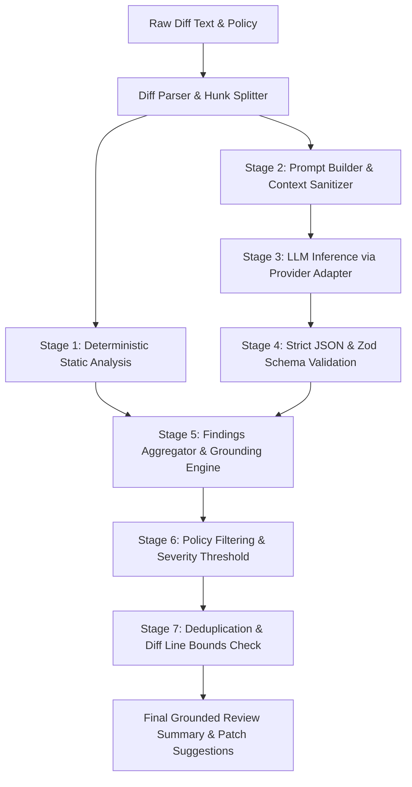

# ReviewFlow AI — AI Code Review Pipeline Specification

ReviewFlow AI implements a hybrid review engine combining fast deterministic static analyzers with deep contextual LLM reasoning.

---

## 1. Pipeline Execution Stages

---

## 2. Review Categories & Severity Levels

### Categories
1. **`SECURITY`**: Hardcoded secrets, token forgery fallbacks, SQL injection, RCE vulnerabilities, XSS, and authorization gaps.
2. **`CORRECTNESS`**: Logic flaws, silent catch blocks, null reference exceptions, and off-by-one errors.
3. **`PERFORMANCE`**: Unindexed database queries, resource leaks, N+1 query antipatterns, and missing caching.
4. **`MAINTAINABILITY`**: Cyclomatic complexity, dead code, poor naming, and lack of modularity.
5. **`TESTING`**: Untested boundary conditions, missing test assertions, and regressions.
6. **`ARCHITECTURE`**: Violations of domain boundaries, circular dependencies, and inappropriate coupling.

### Severity Scale
- **`CRITICAL`**: Security vulnerability, credential leakage, or catastrophic logic failure. Blocks PR merge when `blockPrOnCritical = true`.
- **`HIGH`**: Severe bug, significant race condition, or broken production contract.
- **`MEDIUM`**: Sub-optimal performance, unhandled edge cases, or maintainability risk.
- **`LOW`**: Style deviation, minor optimization, or non-critical improvement.
- **`INFO`**: Constructive feedback, positive reinforcement, or educational tip.

---

## 3. Grounding & Line Number Validation

A major challenge with generative AI code review is "hallucinated line numbers" that cause GitHub review comments API to fail with HTTP 422.

ReviewFlow AI eliminates this with `validateAndGroundFindings`:
1. Scans the parsed `ParsedDiffFile` hunks for each reported finding.
2. If `startLine` does not exist in any added or modified line in the diff, the validator shifts the finding to the closest actual changed line in the same file.
3. If the file itself is not present in the diff, the finding is filtered out and converted into a general PR summary blocker to prevent API rejection.
