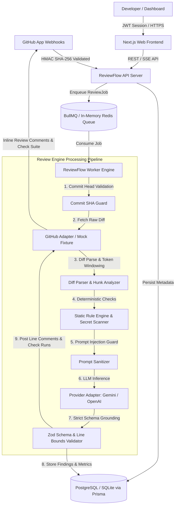

# ReviewFlow AI — System Architecture & Design

ReviewFlow AI is an enterprise-grade AI-powered pull request code review platform. It combines deterministic static analysis (security scanners, regex-based vulnerability heuristics, secret leakage detectors, syntax checkers) with high-context LLM reasoning (semantic flaw discovery, business logic validation, test adequacy evaluation, and automated inline suggestion generation).

---

## 1. High-Level System Architecture

---

## 2. Core Architectural Pillars

### A. Non-Blocking Webhook Ingestion & Idempotency
- Incoming GitHub events (`pull_request.opened`, `synchronize`, `reopened`) hit `/api/v1/webhooks/github`.
- Signatures are verified using raw binary payload streams (`X-Hub-Signature-256`) against the configured webhook secret.
- Every delivery ID (`X-GitHub-Delivery`) is recorded in the `WebhookEvent` table with a unique constraint. Duplicate deliveries are acknowledged immediately with HTTP 200 without duplicate queue dispatch.

### B. Superseded Commit Guards
- If a developer pushes commit `sha-2` while commit `sha-1` is still analyzing, the worker verifies that `pullRequest.headSha === job.commitSha` before executing expensive model inference and publishing GitHub comments.
- Obsolete jobs are transitioned to `SUPERSEDED` status, conserving token budgets and preventing stale review spam.

### C. Grounded Line-Level Finding Validation
- Every finding produced by the LLM is checked against the actual git hunk line ranges.
- If a model proposes a line outside the diff context, the finding is either adjusted to the nearest valid hunk line or downgraded to a PR-level summary comment to guarantee zero 422 Unprocessable Entity errors when calling GitHub's Review Comments API.

### D. Multi-Tenant Organization Isolation
- Every repository, pull request, review job, and finding belongs to an `Organization`.
- Authorization middleware strictly asserts that the requesting authenticated user has an active membership in the matching tenant. Cross-tenant queries are blocked at both route and database layer.

---

## 3. Component Responsibilities

| Package / App | Technology | Responsibility |
| :--- | :--- | :--- |
| `apps/web` | Next.js 14, Tailwind CSS, Framer Motion, Three.js, Lucide | Marketing landing page, 3D interactive hero, architecture explorer, authenticated PR review dashboard, diff viewers, and settings. |
| `apps/api` | Express, TypeScript, Zod, Prisma | RESTful API endpoints, HMAC webhook ingestion, authentication, billing, analytics, and check run queries. |
| `apps/worker` | Node.js, BullMQ/worker runner, Prisma | Asynchronous review orchestration, diff extraction, AI inference, and GitHub API publication. |
| `packages/ai-review` | TypeScript, Zod, Google Gemini / OpenAI SDKs | Deterministic pattern scanner, prompt sanitization, model calls, and structured JSON output validation. |
| `packages/github-client` | Octokit, TypeScript | Unified interface for GitHub App token minting, diff fetching, comments posting, check runs, and offline mock fixture adapters. |
| `packages/database` | Prisma ORM, SQLite / PostgreSQL | Shared schema models, migrations, seeds, and multi-tenant persistence. |
| `packages/shared` | TypeScript, Zod | Shared schemas, enums, interfaces, and validation rules. |
