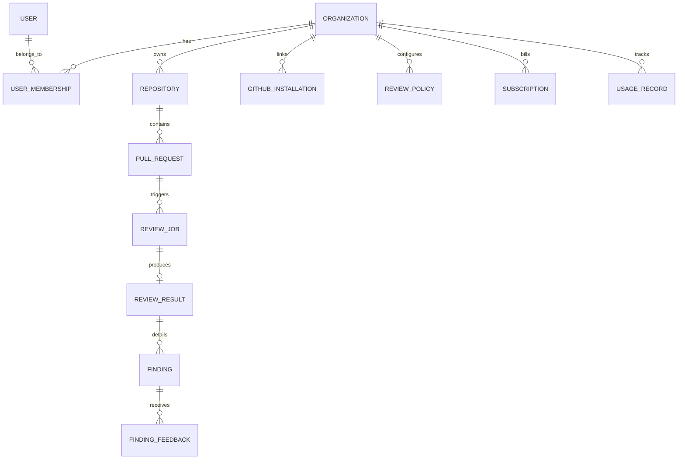

# ReviewFlow AI — Database Schema & Data Models

ReviewFlow AI uses Prisma ORM with support for PostgreSQL (production) and SQLite (zero-config local development).

---

## 1. Entity Relationship Overview

---

## 2. Core Entities & Constraints

### `Organization`
The tenant boundary. All repositories, policies, review records, and billing subscriptions are isolated by `organizationId`.
- `slug` (unique): URL-safe organization handle.
- `plan`: Current tier (`FREE`, `PRO`, `TEAM`, `ENTERPRISE`).
- `stripeCustomerId`, `stripeSubscriptionId`: Stripe billing handles.

### `Repository`
Monitored GitHub repositories.
- `githubRepoId` (unique): Immutable repository identifier.
- `fullName` (unique): e.g. `acme-cloud/auth-service`.
- `autoReviewEnabled`: Feature toggle to pause or activate AI analysis.

### `ReviewPolicy`
Configurable rules per organization with optional repository-level overrides (`repositoryId`).
- `enabledCategories`: JSON array (`SECURITY`, `CORRECTNESS`, `PERFORMANCE`, etc.).
- `severityThreshold`: Minimum severity to surface (`CRITICAL`, `HIGH`, `MEDIUM`, `LOW`, `INFO`).
- `blockPrOnCritical`: When true, marks GitHub Check Run as failed on critical findings.
- `autoPostInlineComments`: Automatically post line-specific comments on GitHub PR diff.
- `customInstructions`: Team-specific instructions injected safely into prompts.

### `ReviewJob` & `ReviewResult`
The execution trace of a review run.
- `commitSha`: Target commit SHA.
- `status`: `QUEUED`, `FETCHING_DIFF`, `ANALYZING`, `VALIDATING`, `COMPLETED`, `FAILED`, `SUPERSEDED`.
- `overallRisk`: `CRITICAL`, `HIGH`, `MEDIUM`, `LOW`, `SAFE`.
- `durationSeconds`, `tokensUsed`, `estimatedCostUsd`: Metered operational metrics.

### `Finding`
Individual defect or vulnerability detected in the pull request.
- `category`, `severity`, `confidence`: Standardized classification.
- `filePath`, `startLine`, `endLine`: Grounded diff location.
- `explanation`, `evidence`, `remediation`, `suggestedPatch`: Actionable fix recommendations.
- `source`: `AI_REASONING` or `DETERMINISTIC_STATIC`.
