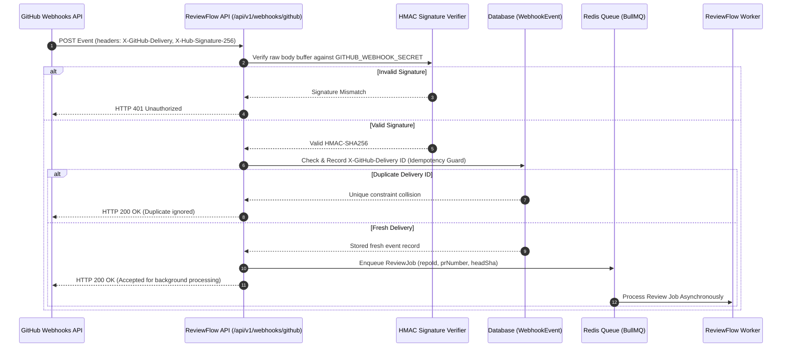

# ReviewFlow AI — GitHub Webhook Architecture & Event Processing

## 1. Webhook Ingestion Flow

GitHub App webhooks trigger automated pull request reviews whenever code is created or updated.

---

## 2. Handled GitHub Webhook Events

| GitHub Event | Action Triggered | ReviewFlow Behavior |
| :--- | :--- | :--- |
| `pull_request.opened` | Pull Request Created | Checks repository `autoReviewEnabled` policy. If active, initializes `ReviewJob` and enqueues analysis. |
| `pull_request.synchronize` | New Commits Pushed | Automatically marks any pending review jobs for previous commit SHAs as `SUPERSEDED`, and enqueues a fresh review for the new `headSha`. |
| `pull_request.reopened` | Pull Request Reopened | Re-evaluates pull request state against default policy. |
| `installation.created` | GitHub App Installed | Syncs account login, organization identifier, and permissions. |
| `installation.deleted` | GitHub App Uninstalled | Soft-deactivates connected repositories and cleans active webhook listeners. |

---

## 3. Webhook Security Safeguards
1. **Raw Body Streaming Verification:** Signature computation uses the untransformed binary stream prior to JSON deserialization.
2. **Replay Defense:** The `WebhookEvent` table enforces a unique constraint on `deliveryId`.
3. **Bounded Processing Limits:** Webhooks acknowledge within 250ms; expensive LLM calls and git operations execute strictly on background workers.
